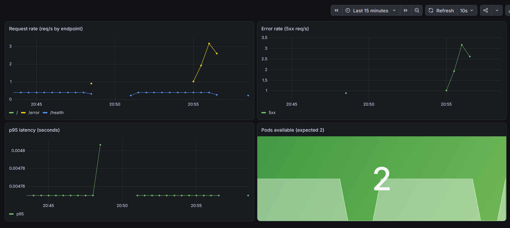

# Terraform AWS Platform

Infrastructure as Code for a small AWS platform: remote state, a reusable VPC module, a Kubernetes cluster, and a Prometheus/Grafana monitoring stack.

## Layout
- bootstrap/: creates the S3 bucket that stores remote state
- modules/vpc/: reusable VPC module (public and private subnets, optional NAT gateway)
- environments/dev/: the dev environment that uses the modules

- ## Phase 3: Observability (Prometheus, Grafana, Alertmanager)

Deployed `kube-prometheus-stack` with Helm onto the EKS cluster, then deployed a Flask app (image in ECR) that exposes Prometheus metrics at `/metrics`.

- **App:** Flask + gunicorn, 2 replicas, with request count and latency metrics (`prometheus_client`)
- **Scraping:** a `ServiceMonitor` tells Prometheus to scrape the app every 15 seconds
- **Alerting:** a `PrometheusRule` fires `FlaskAppPodDown` when fewer than 2 pods are available for 1 minute
- **Dashboard:** request rate, 5xx error rate, p95 latency, and pods available, loaded into Grafana as a ConfigMap so it lives in the repo

Manifests are in `k8s/` and the app is in `app/`.

### Proving the alert works

I scaled the deployment to 0 on purpose and watched the alert move through each state:

```
FlaskAppPodDown inactive ok     # healthy
FlaskAppPodDown pending         # 20s after scale-down
FlaskAppPodDown firing          # after the 1m "for" window
FlaskAppPodDown active          # received by Alertmanager
resolved                        # after scaling back to 2
```

Healthy:


Outage (pods at 0, alert firing):


Recovered:


### Issues hit and fixes

- **Prometheus never started on first install:** the Helm release timed out and showed `failed`. Raised `maximumStartupDurationSeconds` to 600 and ran `helm upgrade`.
- **Grafana unreachable from CloudShell:** changed the service to a LoadBalancer restricted to my IP.
- **Dashboard showed `http` instead of endpoint names:** the ServiceMonitor's `endpoint` label overrode the app's label. Switched the queries to `exported_endpoint`.
- **`PrometheusOperatorRejectedResources` alert:** leftover from the failed first install. The rejections stopped after the upgrade.
