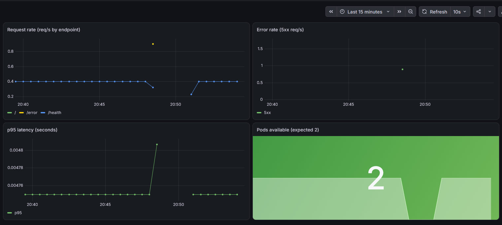
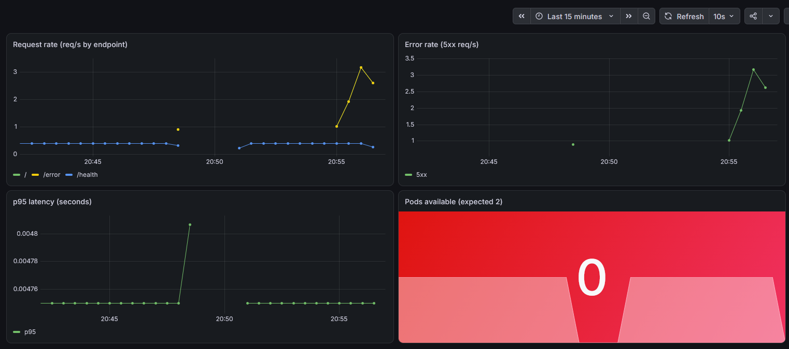
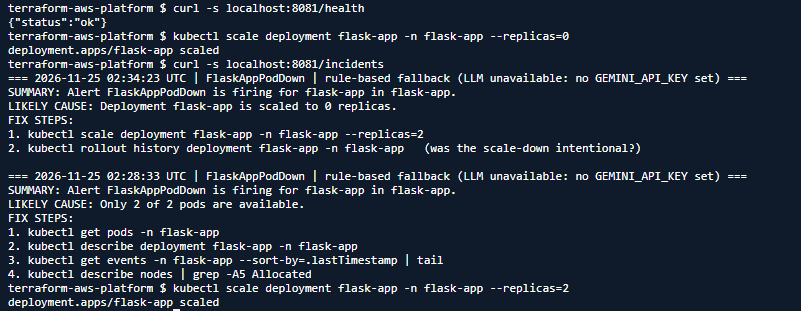

# Terraform AWS Platform

Infrastructure as Code for a small AWS platform: remote state, a reusable VPC module, an EKS Kubernetes cluster, a Prometheus/Grafana monitoring stack, and a webhook-driven incident triage service.

## Layout

- `bootstrap/`: creates the S3 bucket that stores remote state
- `modules/vpc/`: reusable VPC module (public and private subnets, optional NAT gateway)
- `modules/eks/`: reusable EKS cluster module
- `environments/dev/`: the dev environment that uses the modules
- `app/`: Flask demo app with a `/metrics` endpoint
- `k8s/`: Kubernetes manifests (app, ServiceMonitor, alert rule, dashboard, Alertmanager routing)
- `incident-bot/`: Python webhook service for incident triage
- `docs/`: screenshots

## Phase 1: Terraform foundation

Built the network and state backend as code, split into reusable modules.

- **Remote state:** a separate `bootstrap/` configuration creates the S3 bucket that holds Terraform state, and `environments/dev` stores its state there through `backend.tf`. Bootstrapping separately avoids the chicken-and-egg problem of a state bucket that has to exist before Terraform can use it.
- **VPC module:** `modules/vpc` creates a VPC with public and private subnets and an optional NAT gateway, controlled by a variable so the dev environment can skip that cost when it isn't needed.
- **Environment layout:** `environments/dev` calls the modules and exposes outputs, so a future `prod` environment can reuse the same modules with different inputs.

## Phase 2: Kubernetes cluster from Terraform

Added `modules/eks` and wired it into `environments/dev`, so one `terraform apply` builds the network and an EKS cluster on top of it.

- **EKS cluster:** a managed EKS control plane with a managed node group of two worker nodes in `us-east-2`, placed in the VPC subnets from Phase 1.
- **Module reuse:** the EKS module takes the VPC module's outputs as inputs, so networking and compute stay separate but connected.
- **Access:** after apply, `aws eks update-kubeconfig` points `kubectl` at the cluster, and both nodes report `Ready`.

## Phase 3: Observability (Prometheus, Grafana, Alertmanager)

Deployed `kube-prometheus-stack` with Helm onto the EKS cluster, then deployed a Flask app (image in ECR) that exposes Prometheus metrics at `/metrics`.

- **App:** Flask + gunicorn, 2 replicas, with request count and latency metrics (`prometheus_client`)
- **Scraping:** a `ServiceMonitor` tells Prometheus to scrape the app every 15 seconds
- **Alerting:** a `PrometheusRule` fires `FlaskAppPodDown` when fewer than 2 pods are available for 1 minute
- **Dashboard:** request rate, 5xx error rate, p95 latency, and pods available, loaded into Grafana as a ConfigMap so it lives in the repo

### Proving the alert works

I scaled the deployment to 0 on purpose and watched the alert move through each state:

```
FlaskAppPodDown inactive ok     # healthy
FlaskAppPodDown pending         # 20s after scale-down
FlaskAppPodDown firing          # after the 1m "for" window
FlaskAppPodDown active          # received by Alertmanager
resolved                        # after scaling back to 2
```

Healthy:


Outage (pods at 0, alert firing):


Recovered:


## Phase 4: Webhook-driven incident triage

When `FlaskAppPodDown` fires, Alertmanager sends a webhook to a small Python service (`incident-bot`) running in the cluster.

- **Routing:** an `AlertmanagerConfig` sends `FlaskAppPodDown` alerts to the bot's webhook
- **Context:** the bot queries the Kubernetes API (read-only ClusterRole: pods, events, deployments) for the deployment's desired and available replicas, pod status, and recent warning events
- **Output:** a summary, likely cause, and fix steps, served at `/incidents`
- **LLM backend:** the service can ask the Gemini API for the summary, and falls back to a rule-based summary if no key is set or the call fails. I ran it without an API key, so the results below are from the rule-based path.

### Result

I scaled the app to 0 on purpose. The alert fired, Alertmanager called the bot, and it identified the cause from live cluster state:



## Issues hit and fixes

- **Phase 3, Prometheus never started on first install:** the Helm release timed out and showed `failed`. Raised `maximumStartupDurationSeconds` to 600 and ran `helm upgrade`.
- **Phase 3, Grafana unreachable from CloudShell:** changed the service to a LoadBalancer restricted to my IP.
- **Phase 3, dashboard showed `http` instead of endpoint names:** the ServiceMonitor's `endpoint` label overrode the app's label. Switched the queries to `exported_endpoint`.
- **Phase 3, `PrometheusOperatorRejectedResources` alert:** leftover from the failed first install. The rejections stopped after the upgrade.
- **Phase 4, `AlertmanagerConfig` scoping:** the Prometheus Operator limits these routes to alerts from the config's own namespace, so the config lives in `flask-app`, where the alert's `namespace` label points.
- **Phase 4, webhook timeouts:** LLM calls can be slow, so the webhook handler returns immediately and processes the alert in a background thread.
- **Phase 4, no LLM key:** Gemini's API key page required billing details, so I kept the LLM path optional and shipped the rule-based fallback.

## Cost note

The EKS cluster, nodes, NAT gateway, and load balancers bill by the hour. When not in use, remove the Grafana load balancer, then run `terraform destroy` in `environments/dev`.
